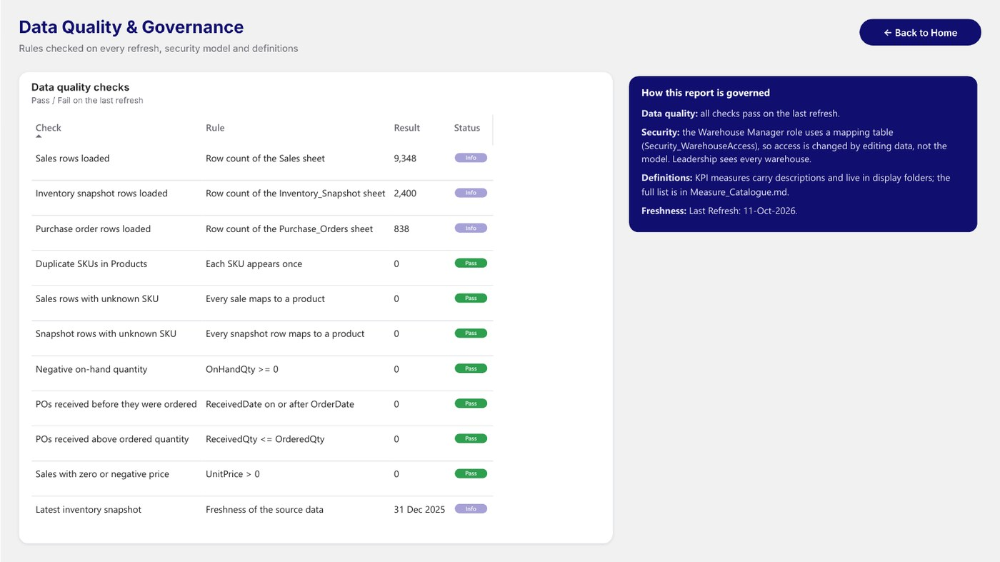

# Inventory Management

> **Business question:** Revenue is up 21.8%, so why are stockouts rising?

`Operations` · Oct 2026 · `Power BI` · `DAX` · `Data modeling` · `Power Query` · `RLS`

## Key findings

- Revenue reached **$15.51M** (+21.8% vs last year) with **$7.75M** gross profit.
- The stockout rate climbed to **6.3%** from 5.5% last year, even as inventory turnover improved to 6.05.
- Marketplace is the largest sales channel at about 40% of revenue; Electronics and Apparel lead by category.

## About the report

Five report pages: Executive Overview, Inventory Operations, Supplier & Warehouse Performance, Inventory Detail with ABC classification, and Data Quality & Governance. Row-level security by warehouse (mapping table), descriptions on every KPI measure and a catalogue of 147 measures. UI inspired by Arbaz Ahmad's Inventory Management Dashboard (Microsoft Fabric Community); the data model, DAX and visuals were built independently.

## Report pages

### Executive Overview

### Inventory Operations

### Supplier & Warehouse Performance

### Inventory Detail

### Data Quality & Governance

## Full report

📄 [Inventory_Management.pdf](Inventory_Management.pdf)

## Open it in Power BI Desktop

This folder is a Power BI Project (PBIP): the report and semantic model are saved as text (PBIR + TMDL), so every change can be reviewed in Git. Open `Inventory Management.pbip`, point the *DataFilePath* parameter at the data file in this folder if needed, and refresh. KPI rows use the free **HTML Content** visual from AppSource.

## Under the hood

**Business question:** revenue is up 21.8%, so why are stockouts rising?

UI inspired by Arbaz Ahmad's Inventory Management Dashboard (Microsoft Fabric Community); the data model, DAX and visuals were built independently.

### Pages
1. **Home**: navigation.
2. **Executive Overview**: revenue, gross profit, inventory value, stockout rate and turnover vs last year; revenue trend, channel and category mix, top products with ABC class.
3. **Inventory Operations**: low-stock SKUs, days of supply, inventory health distribution, products below their reorder point.
4. **Supplier & Warehouse Performance**: lead time, DIO, warehouse performance, supplier scorecard and risk matrix.
5. **Inventory Detail**: SKU-level stock, restock cost and lead time.
6. **Data Quality & Governance**: checks that run on every refresh, the security model and definitions.

### Data model
Star schema: `Fact_Sales`, `Fact_Inventory` (monthly snapshot) and `Fact_PurchaseOrders` with `Products`, `Suppliers`, `Warehouses` and a marked `Dim_Date`. Field-parameter style helper tables (`Trend Metric`, `Ops Metric`, `Supplier Metric`, `Warehouse Metric`, `Contribution Metric`, `Breakdown`, `Top N`, `Health View`) drive the metric switches. The file path is the `DataFilePath` parameter.

### Governance added in this version
- **Row-level security**
  - `Warehouse Manager`: dynamic RLS with a mapping table. `Security_WarehouseAccess` maps each sign-in (`USERPRINCIPALNAME()`) to warehouses (WH-E, WH-C, WH-W); the filter flows Warehouses → Products → facts, so access changes by editing data, not the model.
  - `Inventory Leadership`: reads every warehouse.
  - Test both with *Modeling → View as*.
- **Data quality page** (`Dim_DQ` + `DQ Value` / `DQ Status` measures): row counts per source sheet, duplicate SKUs, sales and snapshot rows with an unknown SKU, negative on-hand quantity, POs received before they were ordered or above the ordered quantity, zero or negative prices, and the latest snapshot date.
- **Documentation**: every KPI measure has a description and lives in a display folder. The full list of 147 measures is in `Measure_Catalogue.md`.

### How to open
Open `Inventory Management.pbip` in Power BI Desktop. If the folder is not `Desktop\\Inventory Management Dashboard`, update the *DataFilePath* parameter to `Inventory_Sample_Data.xlsx` and refresh. KPI visuals use the free **HTML Content** visual from AppSource.

---

[← All projects](../README.md) · [Portfolio](https://youssefsaeed-portfolio.vercel.app/)
