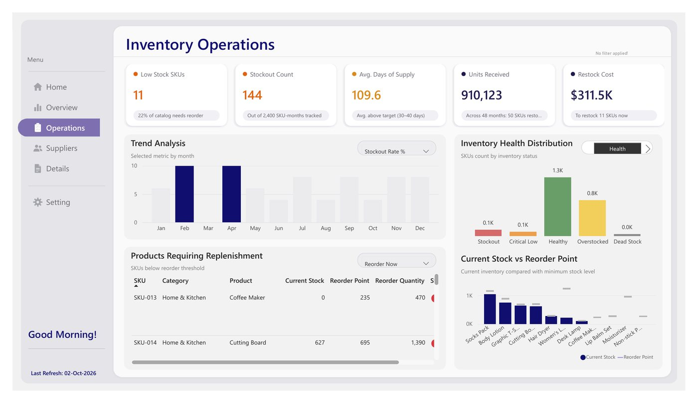
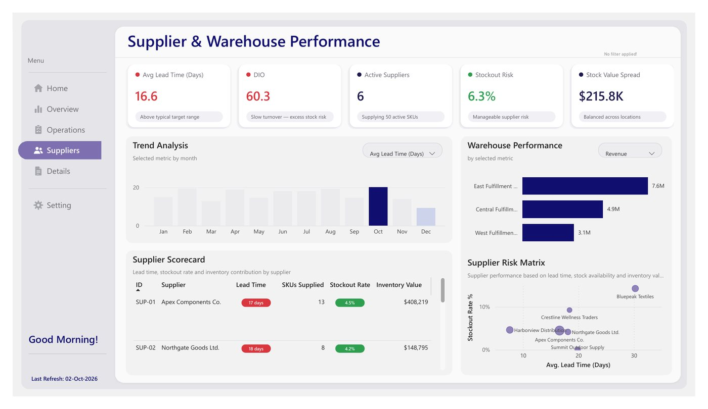
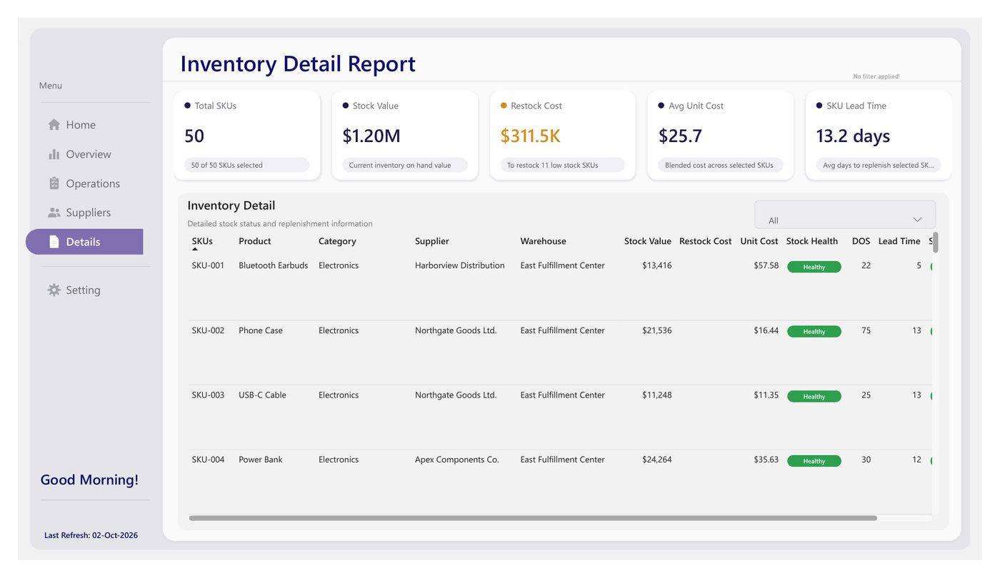

# Inventory Management

> **Business question:** Revenue is up 21.8%, so why are stockouts rising?

`Operations` · Oct 2026 · `Power BI` · `DAX` · `Data modeling` · `Power Query`

## Key findings

- Revenue reached **$15.51M** (+21.8% vs last year) with **$7.75M** gross profit.
- The stockout rate climbed to **6.3%** from 5.5% last year, even as inventory turnover improved to 6.05.
- Marketplace is the largest sales channel at about 40% of revenue; Electronics and Apparel lead by category.

## About the report

Four report pages: Executive Overview, Inventory Operations, Supplier & Warehouse Performance, and an Inventory Detail report with ABC classification. Built on a rebuilt data model with refactored DAX for cleaner, easier-to-maintain logic.

## Report pages

### Executive Overview

### Inventory Operations

### Supplier & Warehouse Performance

### Inventory Detail

## Full report

📄 [Inventory_Management.pdf](Inventory_Management.pdf)

---

[← All projects](../README.md) · [Portfolio](https://youssefsaeed-portfolio.vercel.app/)
