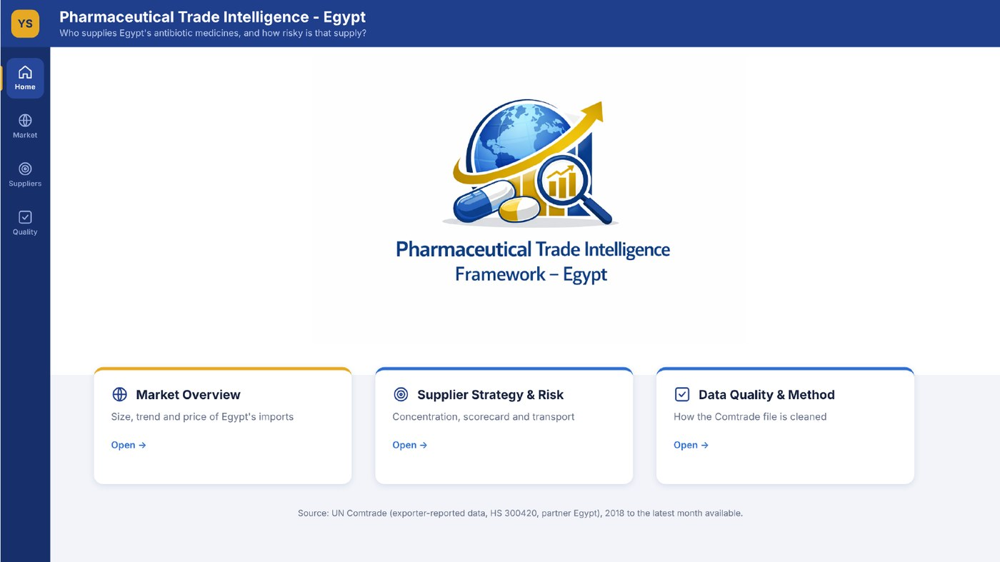
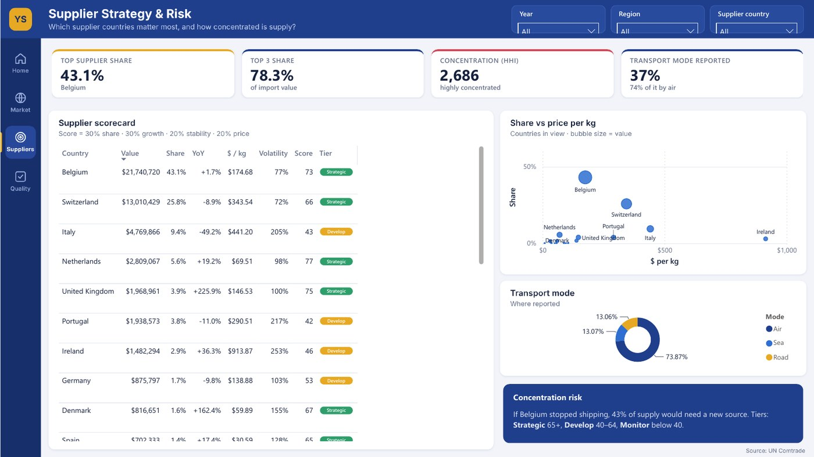
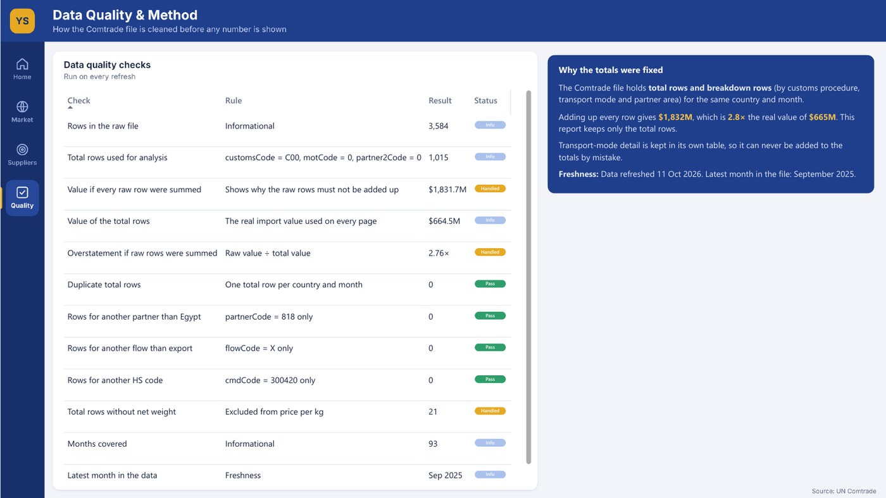

# Pharmaceutical Trade Intelligence, Egypt

> **Business question:** Who supplies Egypt's antibiotic medicines, and how concentrated is that supply?

`Market` · Feb 2026 · `Power BI` · `Power Query` · `DAX` · `Data quality`

> **Real data:** UN Comtrade, included as `Trade_Data.csv`.

## Key findings

- Imports in January to September 2025 were **$50.5M**, down **16.5%** on the same months of 2024.
- **Belgium (43%)** and **Switzerland (26%)** supply most of it; concentration (HHI) is **2,686**, highly concentrated.
- The first version summed every row of the Comtrade file and overstated imports **2.76×** ($1.83B instead of $665M). The rebuilt model loads only the total rows.

## About the report

Real UN Comtrade data (HS 300420, partner Egypt, 2018 to September 2025). Pages: Home, Market Overview, Supplier Strategy & Risk (0–100 supplier score) and Data Quality & Method.

## Report pages

### Home

### Market Overview

### Supplier Strategy & Risk

### Data Quality & Method

## Full report

📄 [Pharmaceutical_Trade_Intelligence_Egypt.pdf](Pharmaceutical_Trade_Intelligence_Egypt.pdf)

## Open it in Power BI Desktop

This folder is a Power BI Project (PBIP): the report and semantic model are saved as text (PBIR + TMDL), so every change can be reviewed in Git. Open `Pharmaceutical Trade Intelligence - Egypt.pbip`, point the *DataFilePath* parameter at the data file in this folder if needed, and refresh. KPI rows use the free **HTML Content** visual from AppSource.

## Under the hood

**Business question:** who supplies Egypt's antibiotic medicines (HS 300420), and how risky is that supply?

Source: UN Comtrade, monthly exports to Egypt as reported by 31 exporting countries, January 2018 to September 2025 (`Trade_Data.csv`).

### What changed in this version
- **Fixed a double-counting problem.** The Comtrade file has total rows *and* breakdown rows (customs procedure, transport mode, partner area) for the same country and month. Summing every row gave **$1,832M**; the real value is **$665M** (2.76× overstated). The model now loads only the total rows into `Fact_Trade`.
- **Fixed broken visuals:** two visuals used a measure called `Total Volume` that did not exist in the model.
- **Fair year-on-year:** 2025 has nine months, so growth compares January–September with the same months of 2024.
- **One source, one parameter:** the CSV is read once (`Trade_Raw`, not loaded) and every table references it. The file path is the `DataFilePath` parameter.
- **Auto date/time disabled** and a single marked date table, so there are no hidden date tables.
- **New pages** with a consistent theme, dynamic insights written by DAX, a 0–100 supplier score and a data quality page.

### Headline figures (January–September 2025)
- Import value: **$50.5M**, -16.5% vs January–September 2024 ($60.4M)
- Largest suppliers: Belgium 43%, Switzerland 26%, Italy 9%
- Concentration (HHI): **2,686** (highly concentrated)
- Average price: **$174.92 per kg**

### Data model

| Table | Role | Columns |
|---|---|---|
| Fact_Trade | Fact | Date |
| Fact_Transport | Fact | Mode |
| Dim_Supplier | Dimension | ISO, Country, Region |
| DQ_Source | Helper | (hidden keys) |
| Dim_Date | Dimension | Date, Year, Quarter, Month, Year-Month |
| Trend Year | Helper | Year |
| Dim_DQ | Dimension | Check, Rule |
| _Refresh | Helper | (hidden keys) |

#### Relationships

All single direction, many-to-one from fact to dimension.

- `Fact_Trade.Date` → `Dim_Date.Date`
- `Fact_Trade.ReporterCode` → `Dim_Supplier.ReporterCode`
- `Fact_Transport.Date` → `Dim_Date.Date`
- `Fact_Transport.ReporterCode` → `Dim_Supplier.ReporterCode`

#### Security roles

- **Regional Analyst**: Example row-level security role: limits the report to European supplier countries. Rule: `Dim_Supplier`: `Dim_Supplier[Region] = "Europe"`

### How to open
1. Unzip to `Desktop\\Portfolio Dashboards\\Pharmaceutical Trade Intelligence - Egypt` (the CSV is inside), or change *Transform data → Edit parameters → DataFilePath*.
2. Open the `.pbip` file in Power BI Desktop and refresh.
3. KPI cards and insight boxes use the free **HTML Content** visual (AppSource).

---

[← All projects](../README.md) · [Portfolio](https://youssefsaeed-portfolio.vercel.app/)
