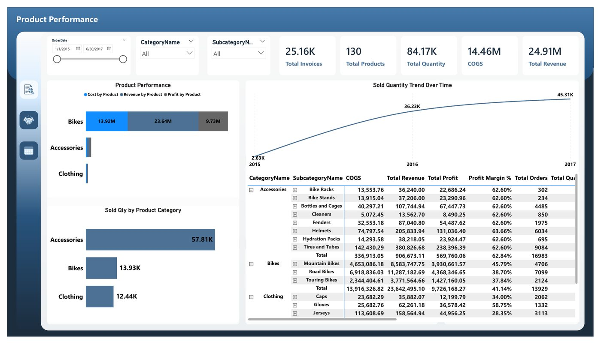
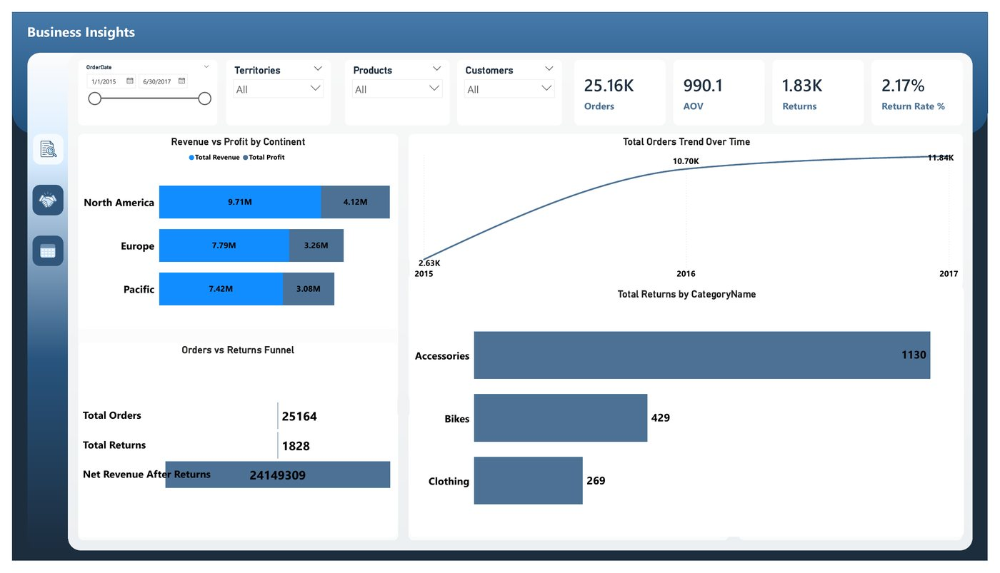
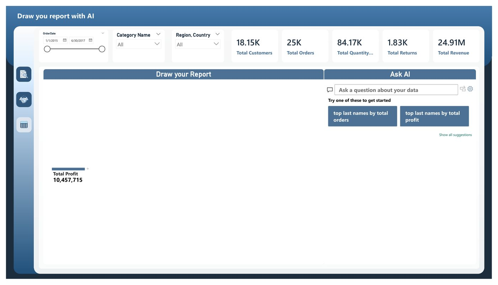

# Sales Tracker

> **Business question:** How much does the business depend on one category?

`Sales` · Sep 2025 · `Power BI` · `DAX`

## Key findings

- **$24.91M** total revenue, **$10.46M** profit, **41.97%** profit margin.
- Bikes generate **$23.64M (94.89%)** of revenue; accessories and clothing are a small share.
- Australia and the Southwest region lead total orders.

## About the report

Tracks revenue, COGS and profit from 2015 to mid-2017 by category and region, with an executive overview, product performance and business insights pages, plus a page where users draw their own report with AI.

## Report pages

### Executive Overview

### Product Performance

### Business Insights

### Draw your report with AI

## Full report

📄 [Sales_Tracker.pdf](Sales_Tracker.pdf)

---

[← All projects](../README.md) · [Portfolio](https://youssefsaeed1.github.io/portfolio/)
