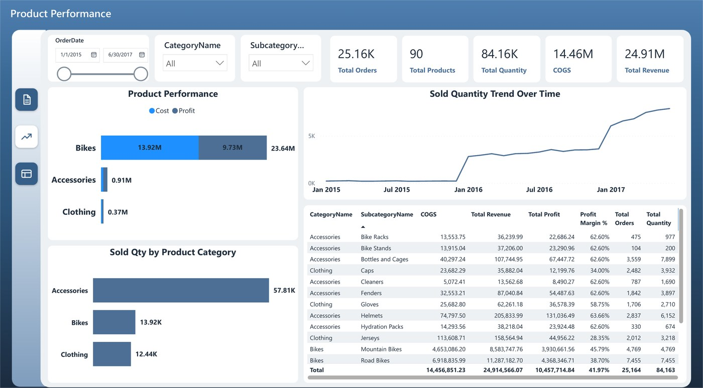
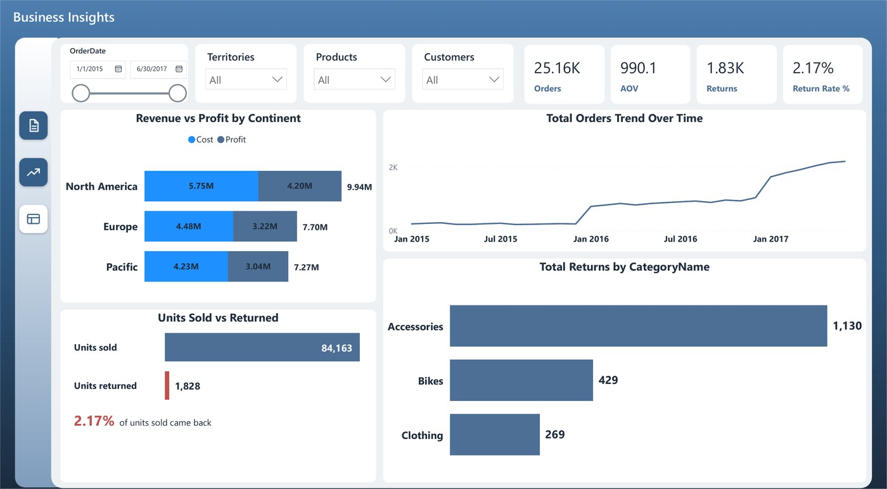

# Sales Tracker

> **Decision:** Keep relying on bikes, or grow higher-margin accessories?

`Sales` · Sep 2025 · `Power BI` · `DAX`

> **Sample data.** Generated data with the same headline figures as the company report, included in this folder so the project opens and refreshes.

## Key findings

- **24.91M** revenue, **10.46M** profit, **41.97%** profit margin.
- Bikes bring in **23.64M (94.89%)** of revenue; accessories sell the most units (57.81K) but earn little.
- **2.17%** of units sold come back, and accessories account for 1,130 of the 1,828 returned units.

## About the report

Tracks revenue, cost and profit from January 2015 to June 2017 by category, region and continent, across three pages: executive overview, product performance and business insights.

## Report pages

### Executive | Overview

### Product Performance

### Business Insights

## Full report

📄 [Sales_Tracker.pdf](Sales_Tracker.pdf)

## Open it in Power BI Desktop

This folder is a Power BI Project (PBIP): the report and semantic model are saved as text (PBIR + TMDL), so every change can be reviewed in Git. Open `Sales Tracker.pbip`, point the *DataFilePath* parameter at `Sales_Sample_Data.xlsx` in this folder if needed, and refresh. To get a single file, use *File → Save as* and choose `.pbix`. KPI cards use the free **HTML Content** visual from AppSource.

## Under the hood

**Decision:** Keep relying on bikes, or grow higher-margin accessories?

My Sales Tracker dashboard for a bike retailer (January 2015 – June 2017) as a documented Power BI project.
**Sample data:** generated data with these headline
figures: 24.91M revenue, 14.46M COGS, 10.46M profit (41.97% margin), 25.16K orders, 84.16K units and 1.83K returned units.

### Pages
1. **Executive | Overview**: KPIs, annual revenue vs cost, monthly revenue and profit, revenue and profit by category, orders by region.
2. **Product Performance**: KPIs, cost + profit by category, units by category and month, category / sub-category matrix.
3. **Business Insights**: KPIs, cost + profit by continent, orders by month, units sold vs returned, returns by category.

### Data model

| Table | Role | Columns |
|---|---|---|
| Fact_Sales | Fact | OrderDate, OrderNumber |
| Fact_Returns | Fact | ReturnDate |
| Dim_Product | Dimension | ProductName, Subcategory, Category, ProductCost, ProductPrice |
| Dim_Customer | Dimension | Occupation |
| Dim_Territory | Dimension | Region, Country, Continent |
| Dim_Date | Dimension | Date, Year, Quarter, Month, Year-Month, Month Start |
| Security_TerritoryAccess | Helper | UserEmail, Continent |
| Dim_DQ | Dimension | Check, Rule |
| _Refresh | Helper | (hidden keys) |

#### Relationships

All single direction, many-to-one from fact to dimension.

- `Fact_Sales.OrderDate` → `Dim_Date.Date`
- `Fact_Sales.ProductKey` → `Dim_Product.ProductKey`
- `Fact_Sales.CustomerKey` → `Dim_Customer.CustomerKey`
- `Fact_Sales.TerritoryKey` → `Dim_Territory.TerritoryKey`
- `Fact_Returns.ReturnDate` → `Dim_Date.Date`
- `Fact_Returns.ProductKey` → `Dim_Product.ProductKey`
- `Fact_Returns.TerritoryKey` → `Dim_Territory.TerritoryKey`

#### Security roles

- **Sales Manager**: Dynamic row-level security: each sales manager sees the continents mapped to their sign-in. Rule: `Dim_Territory`: `Dim_Territory[Continent] IN CALCULATETABLE ( VALUES ( Security_TerritoryAccess[Continent] ), Security_TerritoryAccess[UserEmail] = USERPRINCIPALNAME () )`
- **Sales Leadership**: Full read access. Rule: no filter (full read)

---

[← All projects](../README.md) · [Portfolio](https://youssefsaeed-portfolio.vercel.app/)
