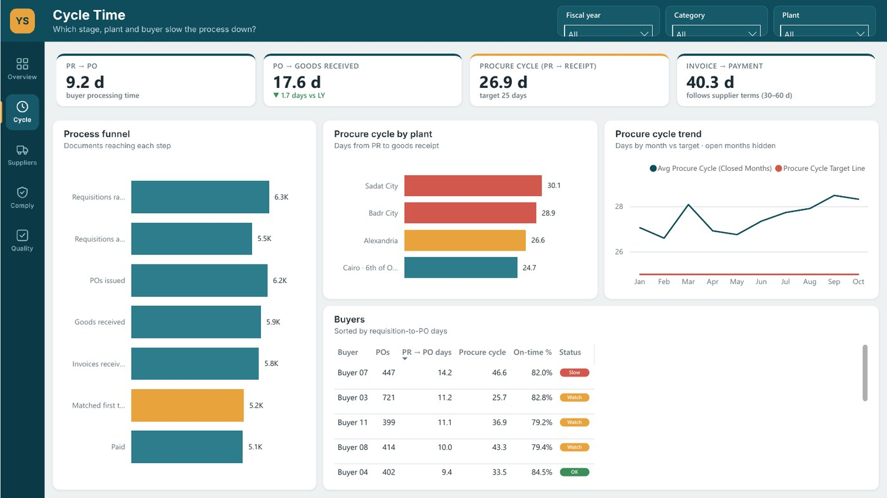
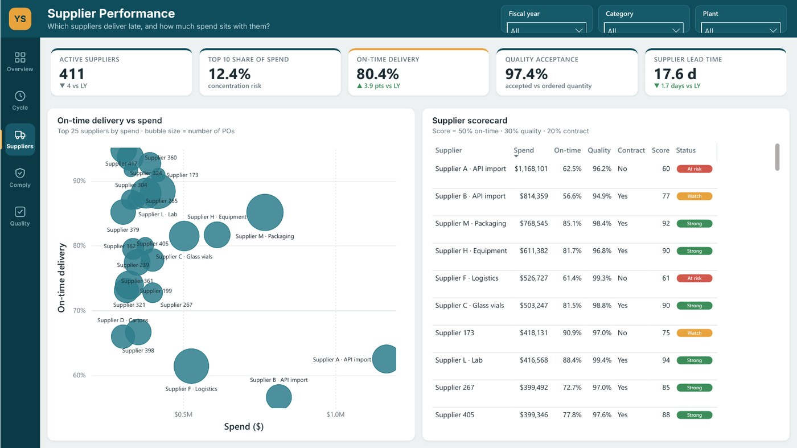
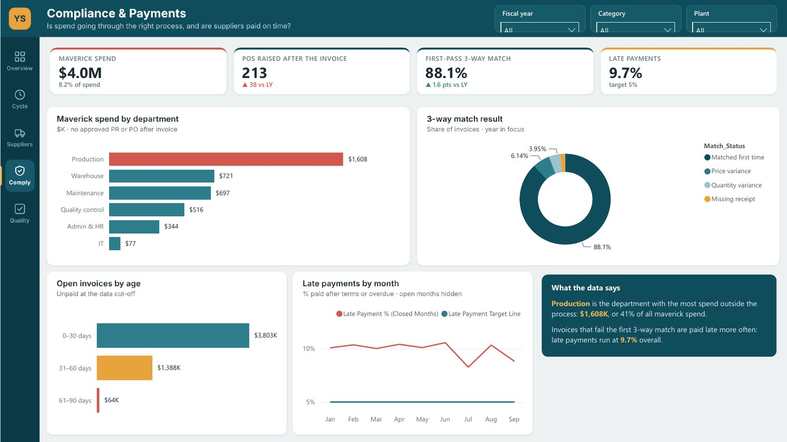
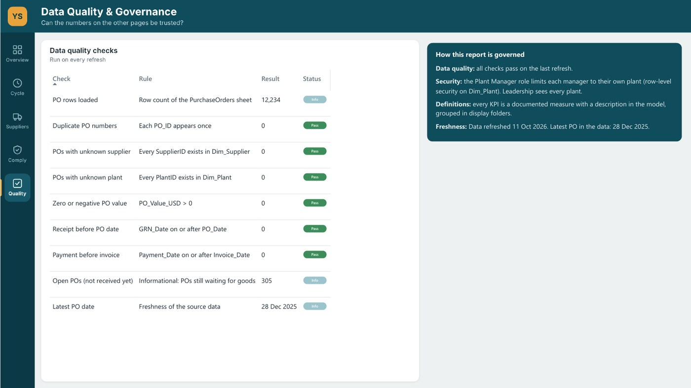

# Procure-to-Pay Performance

> **Decision:** Which suppliers and plants should we fix first to cut delays and off-contract buying?

`Operations` · Jun 2025 · `Power BI` · `DAX` · `Governance` · `RLS`

> **Sample data.** The figures come from a generated dataset, included in this folder so the project opens and refreshes.

## Key findings

- In FY2025, **$48.6M** of spend took **26.9 days** from request to goods receipt against a 25-day target.
- **80.4%** of deliveries arrived on time (target 90%); **8.2%** of spend was maverick buying.
- Late payments run at **9.7%**, counting unpaid invoices that are already past due.

## About the report

Follows 12,234 purchase orders from requisition to payment across four plants. Pages: Overview, Cycle Time, Supplier Performance, Compliance & Payments, Data Quality & Governance. Row-level security by plant, a supplier scorecard, and trend charts that hide months that are still open.

## Report pages

### Overview

### Cycle Time

### Supplier Performance

### Compliance & Payments

### Data Quality & Governance

## Full report

📄 [Procure-to-Pay_Performance.pdf](Procure-to-Pay_Performance.pdf)

## Open it in Power BI Desktop

This folder is a Power BI Project (PBIP): the report and semantic model are saved as text (PBIR + TMDL), so every change can be reviewed in Git. Open `Procure-to-Pay Performance.pbip`, point the *DataFilePath* parameter at the data file in this folder if needed, and refresh. KPI rows use the free **HTML Content** visual from AppSource.

## Under the hood

**Decision:** Which suppliers and plants should we fix first to cut delays and off-contract buying?

A five-page Power BI report that follows every purchase from requisition to payment for a fictional mid-size pharma
manufacturer with four plants in Egypt. **All data is sample data** generated for this portfolio (seeded, reproducible).

### Pages
1. **Overview**: KPIs vs last year, where the days go, monthly spend, spend by category, and insights written by DAX.
2. **Cycle Time**: process funnel, procure cycle by plant and month vs target, buyer table with status.
3. **Suppliers**: on-time delivery vs spend for the top 25 suppliers, supplier scorecard (0–100).
4. **Compliance & Payments**: maverick spend by department, 3-way match result, open invoices by age, late payments.
5. **Data Quality & Governance**: data quality rules checked on every refresh, security and definitions.

### Headline figures in the sample data (FY2025)
| KPI | FY2025 |
|---|---|
| Spend | $48.6M (FY2024: $45.4M) |
| Purchase orders | 6,240 |
| PR → PO | 9.2 days |
| PO → goods received | 17.6 days |
| Procure cycle (PR → receipt) | 26.9 days (target 25) |
| On-time delivery | 80.4% (target 90%) |
| Spend under contract | 79.7% (target 80%) |
| Maverick spend | 8.2% (target 5%) |
| Late payments | 9.7% (target 5%) |

### Data model

| Table | Role | Columns |
|---|---|---|
| Fact_PO | Fact | PO_ID, PR_ID, PR_Date, PO_Date, Promised_Date, GRN_Date, Invoice_Date, Due_Date, Payment_Date, Match_Status |
| Fact_PR | Fact | PR_ID, PR_Date, Approved_Date, Status |
| Dim_Supplier | Dimension | SupplierName, Main_Category, Origin, Has_Contract |
| Dim_Material | Dimension | MaterialName, Category |
| Dim_Plant | Dimension | PlantName, Region |
| Dim_Buyer | Dimension | BuyerName |
| Dim_Department | Dimension | DepartmentName |
| Dim_Date | Dimension | Date, Year, Quarter, Month, Year-Month |
| Dim_Stage | Dimension | Stage |
| Dim_Funnel | Dimension | Step |
| Dim_AgeBucket | Dimension | Age |
| Dim_DQ | Dimension | Check, Rule |
| _Refresh | Helper | (hidden keys) |

#### Relationships

All single direction, many-to-one from fact to dimension.

- `Fact_PO.PO_Date` → `Dim_Date.Date`
- `Fact_PO.SupplierID` → `Dim_Supplier.SupplierID`
- `Fact_PO.MaterialID` → `Dim_Material.MaterialID`
- `Fact_PO.PlantID` → `Dim_Plant.PlantID`
- `Fact_PO.BuyerID` → `Dim_Buyer.BuyerID`
- `Fact_PO.DepartmentID` → `Dim_Department.DepartmentID`
- `Fact_PR.PR_Date` → `Dim_Date.Date`
- `Fact_PR.PlantID` → `Dim_Plant.PlantID`
- `Fact_PR.DepartmentID` → `Dim_Department.DepartmentID`

#### Security roles

- **Plant Manager**: Row-level security: a plant manager sees only the plant whose ManagerEmail matches their sign-in. Rule: `Dim_Plant`: `Dim_Plant[ManagerEmail] = USERPRINCIPALNAME ()`
- **Procurement Leadership**: Full read access to every plant. Rule: no filter (full read)

### Governance
- **Row-level security:** `Plant Manager` role filters `Dim_Plant` to the signed-in user's plant (`USERPRINCIPALNAME()`); `Procurement Leadership` reads everything. Test it in Power BI Desktop with *Modeling → View as*.
- **Single source of truth:** every KPI is a measure with a description, grouped in display folders (see `Measure_Catalogue.md`). Visuals use measures only (implicit measures are disabled).
- **Data quality:** nine rules run on every refresh (duplicates, orphan keys, impossible dates, freshness) and are shown on the Data Quality page.
- **Parameterised source:** one parameter, `DataFilePath`, points at the Excel file. No hard-coded paths in the queries.
- **Targets as measures:** targets live in the `Targets` folder, so they are changed in one place.

### How to open
1. Unzip to `Desktop\Portfolio Dashboards\Procure-to-Pay Performance` (or anywhere you like).
2. Open `Procure-to-Pay Performance.pbip` in Power BI Desktop.
3. If you used another folder: *Transform data → Edit parameters → DataFilePath* and point it at `P2P_Sample_Data.xlsx`, then *Refresh*.
4. The KPI cards and insight boxes use the free **HTML Content** visual from AppSource. Power BI Desktop asks to load it the first time.

---

[← All projects](../README.md) · [Portfolio](https://youssefsaeed-portfolio.vercel.app/)
