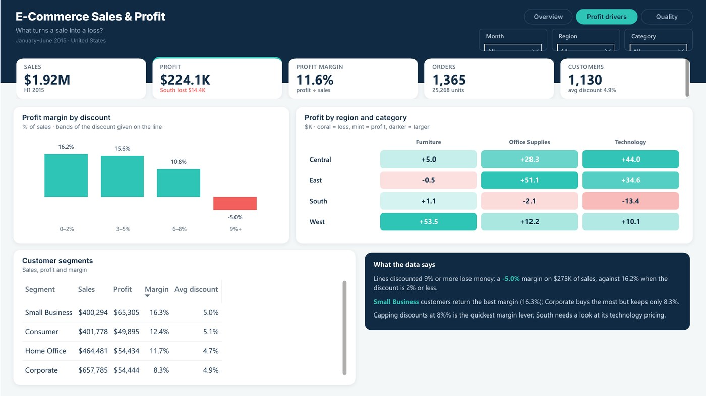
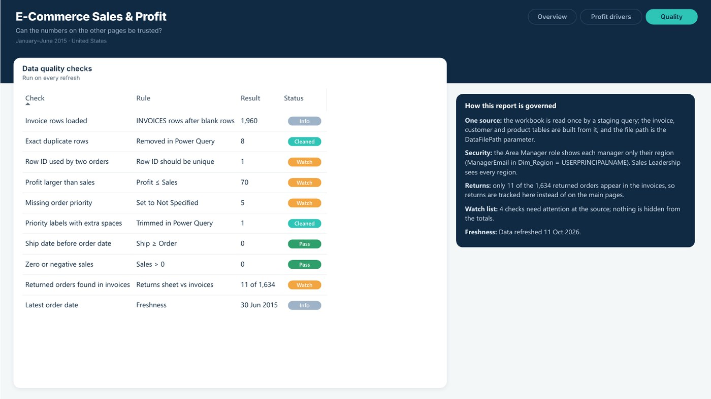

# E‑Commerce Sales & Profit

> **Business question:** Which regions sell well but don't make money?

`Sales` · Aug 2024 · `Power BI` · `Power Query` · `DAX` · `RLS`

> **Data:** the training workbook, included as `E-commerce project.xlsx`.

## Key findings

- **$1.92M** in sales and **$224.1K** profit (11.6% margin) from 1,365 orders, January to June 2015.
- The South region sold **$357K** but **lost $14.4K**. Its discounts match the other regions, so the loss comes from technology, mostly telephones.
- Lines discounted **9% or more** run at a **−5.0%** margin, against 16.2% when the discount is 2% or less.

## About the report

Built on the training workbook. Pages: Overview, Profit drivers (discount bands, region × category heatmap, customer segments) and Data Quality & Governance. One staging query feeds every table, with row-level security by area manager.

## Report pages

### Overview

### Profit drivers

### Data Quality & Governance

## Full report

📄 [E-Commerce_Sales_and_Profit.pdf](E-Commerce_Sales_and_Profit.pdf)

## Open it in Power BI Desktop

This folder is a Power BI Project (PBIP): the report and semantic model are saved as text (PBIR + TMDL), so every change can be reviewed in Git. Open `E-Commerce Sales and Profit.pbip`, point the *DataFilePath* parameter at the data file in this folder if needed, and refresh. KPI rows use the free **HTML Content** visual from AppSource.

## Under the hood

**Business question:** which regions sell well but don't make money?

My 2024 E-Commerce report as a documented Power BI project, built on the training workbook (`E-commerce project.xlsx`, January to June 2015).

### Headline figures
- Sales **$1.92M**, profit **$224.1K**, margin **11.6%**, 1,365 orders from 1,130 customers.
- South sold $357K but lost $14.4K; its discounts match the other regions, the loss comes from technology.
- Lines discounted 9% or more run at a -5.0% margin.

### How the data is handled
- **Orders** are distinct invoice orders, and **Average Discount** is the mean discount rate.
- Only a handful of the returned orders exist in the invoices, so returns are a data quality check.
- One staging query feeds every table, and the file path is the `DataFilePath` parameter.
- 8 exact duplicate rows removed, order priority trimmed, blanks set to *Not Specified*, a marked date table.

### Pages
1. **Overview**: KPIs, sales and profit by month, profit by region (with the area manager), best and worst sub-categories, insights.
2. **Profit drivers**: margin by discount band, profit by region and category, customer segments, insights.
3. **Data Quality & Governance**.

### Data model

| Table | Role | Columns |
|---|---|---|
| Fact_Sales | Fact | Order ID, Customer Segment, Order Priority, Ship Mode |
| Dim_Customer | Dimension | Customer Name, State or Province, City |
| Dim_Product | Dimension | Product Name, Product Sub-Category, Product Category, Product Container |
| Dim_Region | Dimension | Region, Manager, Region Label |
| Dim_DiscountBand | Dimension | Discount Band |
| DQ_Source | Helper | (hidden keys) |
| Dim_DQ | Dimension | Check, Rule |
| Dim_Date | Dimension | Date, Year, Quarter, Month, Year-Month |
| _Refresh | Helper | (hidden keys) |

#### Relationships

All single direction, many-to-one from fact to dimension.

- `Fact_Sales.Order Date` → `Dim_Date.Date`
- `Fact_Sales.Customer ID` → `Dim_Customer.Customer ID`
- `Fact_Sales.Product Name` → `Dim_Product.Product Name`
- `Fact_Sales.Region` → `Dim_Region.Region`

#### Security roles

- **Area Manager**: Each area manager sees only their own region (ManagerEmail in Dim_Region). Rule: `Dim_Region`: `Dim_Region[ManagerEmail] = USERPRINCIPALNAME ()`
- **Sales Leadership**: Full read access to every region. Rule: no filter (full read)

### How to open
Open `E-Commerce Sales and Profit.pbip`. If the folder is not `Desktop\\Portfolio Dashboards\\E-Commerce Sales and Profit`, update *DataFilePath* to the workbook and refresh.
KPI and insight visuals use the free **HTML Content** visual from AppSource. Test security with *Modeling → View as*; replace the example manager e-mails in `Dim_Region` with real sign-ins.

---

[← All projects](../README.md) · [Portfolio](https://youssefsaeed-portfolio.vercel.app/)
