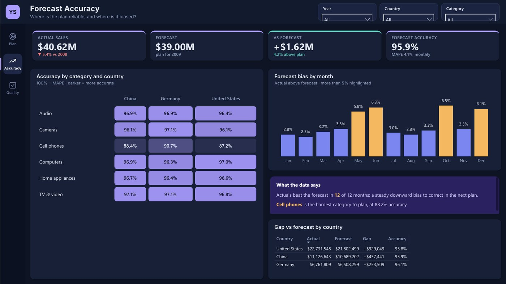
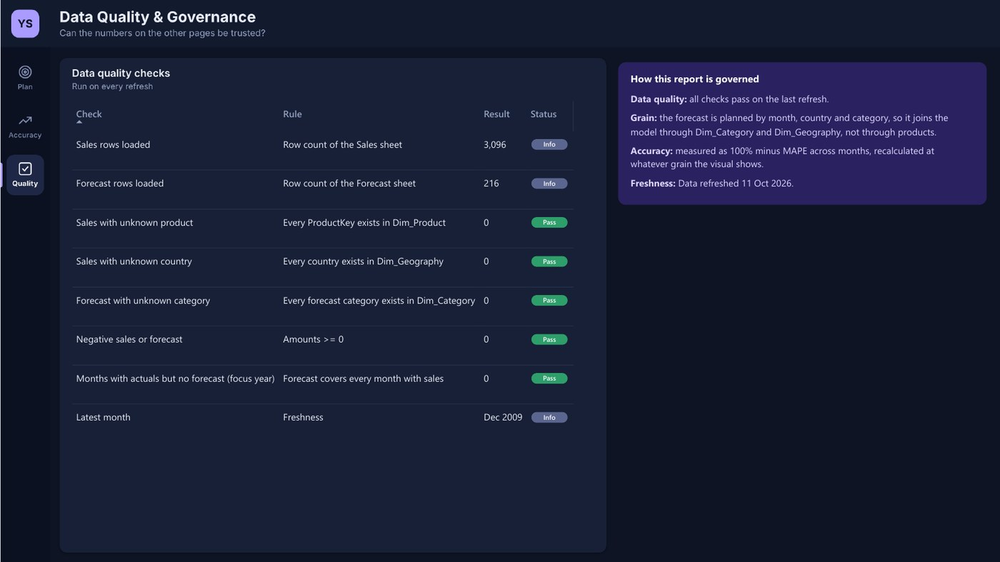

# Sales vs Forecast

> **Business question:** Did 2009 beat the plan, and where did the gap come from?

`Sales` · Oct 2023 · `Power BI` · `DAX` · `Forecasting`

> **Sample data.** The figures come from a generated dataset shaped like the original report, included in this folder so the project opens and refreshes.

## Key findings

- 2009 sales of **$40.62M** were **$2.30M** below 2008 but **$1.62M** above the $39.00M forecast.
- Actuals beat the forecast in 12 of 12 months: a steady downward bias to correct in the next plan.
- Cell phones are the hardest category to plan, at 88.2% accuracy.

## About the report

Pages: Plan vs Actual (with a year-on-year waterfall by country), Forecast Accuracy (heatmap by category and country, monthly bias) and Data Quality & Governance.

## Report pages

### Plan vs Actual

### Forecast Accuracy

### Data Quality & Governance

## Full report

📄 [Sales_vs_Forecast.pdf](Sales_vs_Forecast.pdf)

## Open it in Power BI Desktop

This folder is a Power BI Project (PBIP): the report and semantic model are saved as text (PBIR + TMDL), so every change can be reviewed in Git. Open `Sales vs Forecast.pbip`, point the *DataFilePath* parameter at the data file in this folder if needed, and refresh. KPI rows use the free **HTML Content** visual from AppSource.

## Under the hood

**Business question:** did we beat the plan, and where did the gap come from?

A rebuild of my 2023 "Sales and Forecast" report as a documented Power BI project. **Sample data** shaped like the original
Contoso report: 2009 sales $40.62M, $2.30M below 2008 ($42.92M) and $1.62M above the $39.00M forecast.

### Pages
1. **Plan vs Actual**: KPIs, monthly actual vs forecast vs last year, a year-on-year bridge by country (waterfall), change by category, insights.
2. **Forecast Accuracy**: accuracy heatmap by category × country (100% − MAPE), monthly bias, gap by country.
3. **Data Quality & Governance**.

### Data model

| Table | Role | Columns |
|---|---|---|
| Fact_Sales | Fact | (hidden keys) |
| Fact_Forecast | Fact | (hidden keys) |
| Dim_Product | Dimension | ProductName, Brand |
| Dim_Geography | Dimension | Country, Region |
| Dim_Category | Dimension | Category |
| Dim_Date | Dimension | Date, Year, Quarter, Month, Year-Month |
| Bridge Step | Helper | Step |
| Dim_DQ | Dimension | Check, Rule |
| _Refresh | Helper | (hidden keys) |

#### Relationships

All single direction, many-to-one from fact to dimension.

- `Fact_Sales.MonthStart` → `Dim_Date.Date`
- `Fact_Sales.ProductKey` → `Dim_Product.ProductKey`
- `Fact_Sales.Country` → `Dim_Geography.Country`
- `Fact_Forecast.MonthStart` → `Dim_Date.Date`
- `Fact_Forecast.Country` → `Dim_Geography.Country`
- `Fact_Forecast.Category` → `Dim_Category.Category`
- `Dim_Product.Category` → `Dim_Category.Category`

#### Security roles

- **Country Manager**: Example row-level security role scoped to one country (duplicate per country, or switch to a mapping table). Rule: `Dim_Geography`: `Dim_Geography[Country] = "United States"`

### Modelling notes
- The forecast is planned at month × country × category, so `Fact_Forecast` joins `Dim_Category` and `Dim_Geography` directly and `Dim_Product` rolls up to `Dim_Category`. Actuals and forecast can be compared at any grain both tables share.
- Accuracy is recalculated at the grain of each visual (heatmap cell, country row, total).

### How to open
Open `Sales vs Forecast.pbip`. If the folder is not `Desktop\\Portfolio Dashboards\\Sales vs Forecast`, update *DataFilePath* and refresh.

---

[← All projects](../README.md) · [Portfolio](https://youssefsaeed-portfolio.vercel.app/)
