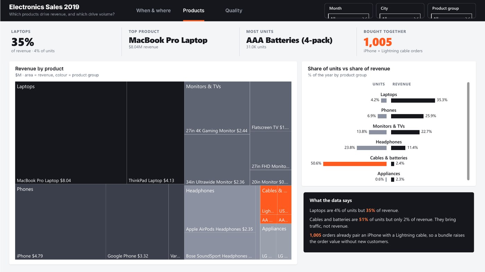
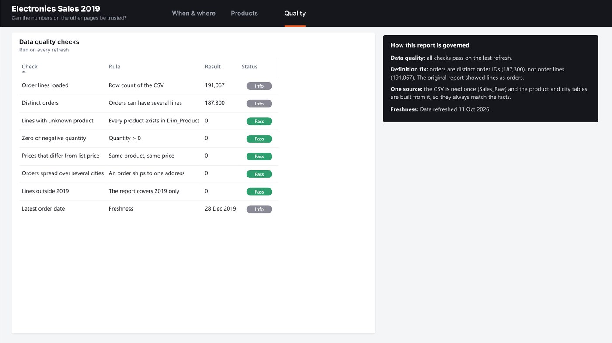

# Electronics Sales 2019

> **Business question:** When and where should marketing spend go?

`Sales` · Sep 2023 · `Power BI` · `Power Query` · `DAX`

> **Sample data.** The figures come from a generated dataset, included in this folder so the project opens and refreshes.

## Key findings

- **$34.49M** from **187.3K** orders across nine US cities; December is the peak month at **$4.65M**.
- October to December bring **34%** of the year's revenue; San Francisco alone brings 24%.
- Laptops are 4% of units but 35% of revenue; 1,005 orders pair an iPhone with a Lightning cable.

## About the report

Pages: When & Where, Products (treemap and units vs revenue) and Data Quality & Governance. Orders are counted by distinct order ID.

## Report pages

### When & Where

### Products

### Data Quality & Governance

## Full report

📄 [Electronics_Sales_2019.pdf](Electronics_Sales_2019.pdf)

## Open it in Power BI Desktop

This folder is a Power BI Project (PBIP): the report and semantic model are saved as text (PBIR + TMDL), so every change can be reviewed in Git. Open `Electronics Sales 2019.pbip`, point the *DataFilePath* parameter at the data file in this folder if needed, and refresh. KPI rows use the free **HTML Content** visual from AppSource.

## Under the hood

**Business question:** when and where should marketing spend go?

My 2023 "Sales Analysis" report as a documented Power BI project. **Sample data** shaped like the public
2019 US electronics store dataset: $34.49M revenue, 209K units, nine cities, December the peak month.

### Pages
1. **When & Where**: KPI ticker, revenue by month with Q4 highlighted, orders by hour as a heat strip, revenue by city, insights.
2. **Products**: treemap of revenue by product, share of units vs share of revenue by product group, products bought together.
3. **Data Quality & Governance**.

### Layout
Pages are tabs in the top bar (no side rail); KPIs are a ticker. Orange marks only what needs action.

### Definitions
**Orders** = distinct order IDs and **Order Lines** is a separate measure (one order can hold several lines).

### Data model

| Table | Role | Columns |
|---|---|---|
| Fact_Sales | Fact | OrderID |
| Dim_Product | Dimension | Product, Product Group, List Price |
| Dim_City | Dimension | City, State |
| Dim_Hour | Dimension | Hour, Hour Label |
| Dim_Date | Dimension | Date, Year, Quarter, Month, Year-Month |
| Dim_DQ | Dimension | Check, Rule |
| _Refresh | Helper | (hidden keys) |

#### Relationships

All single direction, many-to-one from fact to dimension.

- `Fact_Sales.OrderDate` → `Dim_Date.Date`
- `Fact_Sales.Product` → `Dim_Product.Product`
- `Fact_Sales.City` → `Dim_City.City`
- `Fact_Sales.Hour` → `Dim_Hour.Hour`

#### Security roles

- **City Manager**: Example row-level security role for one city. Rule: `Dim_City`: `Dim_City[City] = "San Francisco"`

### How to open
Open `Electronics Sales 2019.pbip`. If the folder is not `Desktop\\Portfolio Dashboards\\Electronics Sales 2019`, update *DataFilePath* to the CSV and refresh.

---

[← All projects](../README.md) · [Portfolio](https://youssefsaeed-portfolio.vercel.app/)
