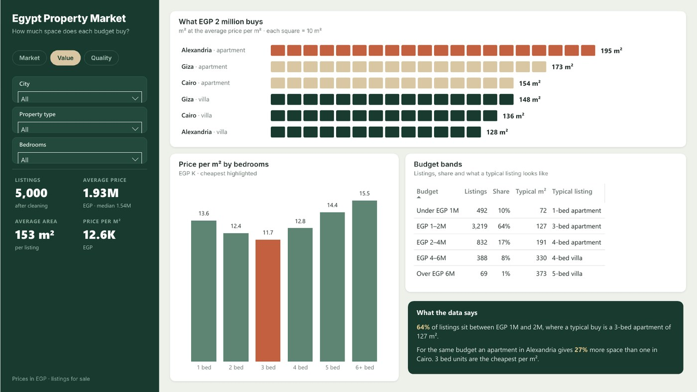
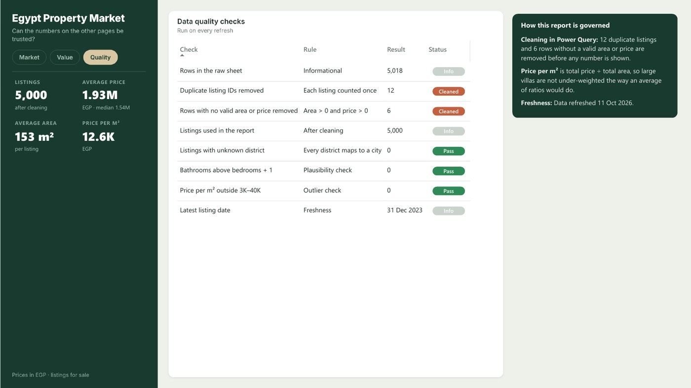

# Egypt Property Market

> **Business question:** Where do buyers get the most space for their money?

`Market` · May 2023 · `Power BI` · `Power Query` · `DAX`

> **Sample data.** The figures come from a generated dataset shaped like the original report, included in this folder so the project opens and refreshes.

## Key findings

- Alexandria villas are the most expensive at **EGP 5.25M** on average; Alexandria apartments are the cheapest per m² (**EGP 10.2K**).
- For EGP 2 million, an apartment in Alexandria gives **27%** more space than one in Cairo.
- Every Cairo district costs more per m² than any district in Giza or Alexandria.

## About the report

5,000 listings across Cairo, Giza and Alexandria, cleaned in Power Query (duplicates and zero-area rows removed). Pages: Market, Value and Data Quality.

## Report pages

### Market

### Value

### Data Quality

## Full report

📄 [Egypt_Property_Market.pdf](Egypt_Property_Market.pdf)

## Open it in Power BI Desktop

This folder is a Power BI Project (PBIP): the report and semantic model are saved as text (PBIR + TMDL), so every change can be reviewed in Git. Open `Egypt Property Market.pbip`, point the *DataFilePath* parameter at the data file in this folder if needed, and refresh. KPI rows use the free **HTML Content** visual from AppSource.

## Under the hood

**Business question:** where do buyers get the most space for their money?

A rebuild of my 2023 Egypt real estate analysis (originally cleaned in Python, shown in Power BI) as a documented Power BI project.
**Sample data:** 5,000 listings for sale in Cairo, Giza and Alexandria, with a few deliberate data issues (duplicates, zero areas) that the model cleans.
As in the original, Alexandria villas are the most expensive segment.

### Layout
Filters, page navigation and the headline numbers sit in a green side panel, like a property search site; the main area compares the three cities side by side.

### Pages
1. **Market**: one card per city (average price and price per m² by type), every listing as a dot (area vs price), price per m² by district, insights.
2. **Value**: what EGP 2 million buys in each city and type, price per m² by bedrooms, budget bands.
3. **Data Quality & Governance**: what was cleaned and why.

### Data model

| Table | Role | Columns |
|---|---|---|
| Fact_Listings | Fact | ListingID, Bathrooms, Furnished, Compound, ListedOn |
| Dim_Location | Dimension | District, City |
| Dim_Type | Dimension | PropertyType |
| Dim_Bedrooms | Dimension | Bedrooms, Bedroom Label |
| Dim_Budget | Dimension | Budget |
| DQ_Source | Helper | (hidden keys) |
| Dim_DQ | Dimension | Check, Rule |
| _Refresh | Helper | (hidden keys) |

#### Relationships

All single direction, many-to-one from fact to dimension.

- `Fact_Listings.District` → `Dim_Location.District`
- `Fact_Listings.PropertyType` → `Dim_Type.PropertyType`
- `Fact_Listings.Bedrooms` → `Dim_Bedrooms.Bedrooms`

#### Security roles

- **Alexandria Agent**: Example row-level security role for a city team. Rule: `Dim_Location`: `Dim_Location[City] = "Alexandria"`

### How to open
Open `Egypt Property Market.pbip`. If the folder is not `Desktop\\Portfolio Dashboards\\Egypt Property Market`, update *DataFilePath* and refresh.

---

[← All projects](../README.md) · [Portfolio](https://youssefsaeed-portfolio.vercel.app/)
