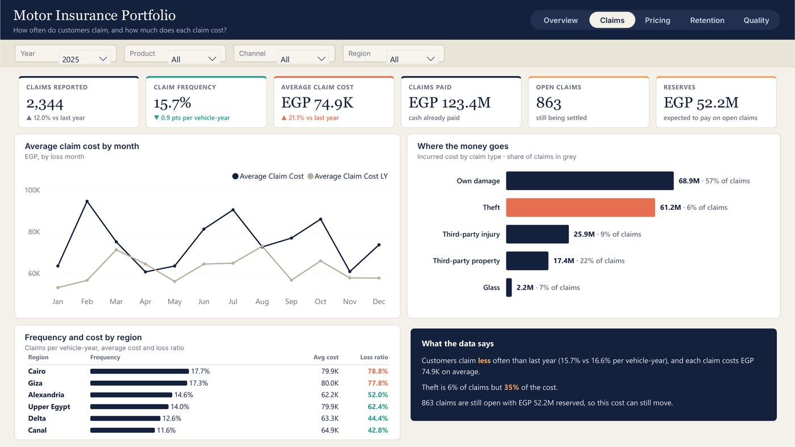
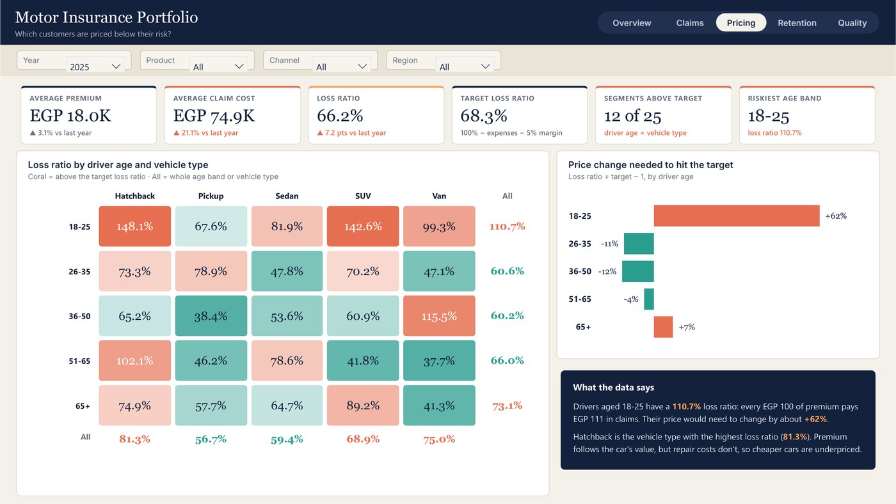
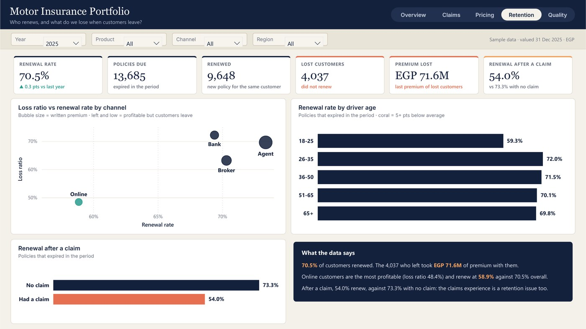
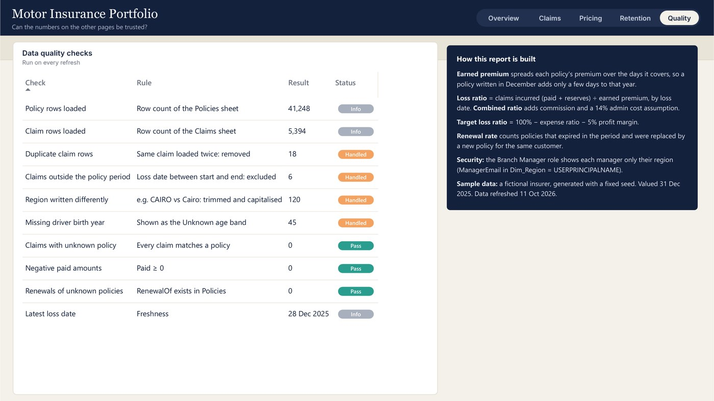

# Motor Insurance Portfolio

> **Decision:** Which customer segments should be repriced, and by how much?

`Insurance` · Jan 2026 · `Power BI` · `Power Query` · `DAX` · `RLS`

> **Sample data.** A fictional motor insurer: 41,248 policies, 2023–2025, valued 31 Dec 2025, in EGP. Generated with a fixed seed (`gen_data.py`) and included in this folder so the project opens and refreshes.

## Key findings

- The 2025 loss ratio is **66.2%** (58.9% in 2024): the average claim cost rose **21.1%** while the average premium rose 3.1%.
- The combined ratio is **92.9%**, an underwriting result of **EGP 18.9M**, so the book still makes money with a thinner margin.
- Drivers aged 18–25 run at a **110.7%** loss ratio; their price would need to rise about **62%** to reach the target.
- Theft is 6% of claims but **35%** of the cost. Online customers have the best loss ratio (48.4%) but renew least (58.9%).

## About the report

Five pages: Overview (premium, claims, loss and combined ratio, premium-to-result waterfall, channels), Claims (frequency, severity, claim types, regions), Pricing (loss ratio by driver age and vehicle type, price change needed), Retention (renewal rate, lost premium, channels, renewal after a claim) and Data Quality. Row-level security by region.

## Report pages

### Overview

### Claims

### Pricing

### Retention

### Data Quality

## Full report

📄 [Motor_Insurance_Portfolio.pdf](Motor_Insurance_Portfolio.pdf)

## Open it in Power BI Desktop

This folder is a Power BI Project (PBIP): the report and semantic model are saved as text (PBIR + TMDL), so every change can be reviewed in Git. Open `Motor Insurance Portfolio.pbip`, point the *DataFilePath* parameter at `Motor_Insurance_Sample.xlsx` in this folder if needed, and refresh. KPI, heatmap and insight visuals use the free **HTML Content** visual from AppSource.

## Under the hood

**Decision:** Which customer segments should be repriced, and by how much?

A motor insurance dashboard for a fictional insurer: 41,248 annual policies and their claims, 2023 to 2025, valued at 31 December 2025, in EGP.
**Sample data:** generated with a fixed seed (`gen_data.py`), so every figure can be reproduced.

### Pages
1. **Overview**: written and earned premium, claims incurred, loss and combined ratio, monthly loss ratio against target, premium-to-result waterfall, channels.
2. **Claims**: frequency, average claim cost, paid vs reserves, cost by claim type, frequency and cost by region.
3. **Pricing**: loss ratio by driver age and vehicle type, price change needed to reach the target loss ratio.
4. **Retention**: renewal rate, lost customers and premium, loss ratio vs renewal by channel, renewal after a claim.
5. **Data Quality**: ten checks run on every refresh, and how the report is built.

### Definitions
- **Earned premium** spreads each policy's premium over the days it covers inside the period.
- **Loss ratio** = claims incurred (paid + reserves) ÷ earned premium, by loss date.
- **Combined ratio** = loss ratio + commission ratio + a 14% admin cost assumption (the sample data has no expense ledger).
- **Target loss ratio** = 100% − expense ratio − 5% profit margin. **Rate change needed** = loss ratio ÷ target − 1.
- **Renewal rate** = policies that expired in the period and were replaced by a new policy for the same customer.

### Data model

| Table | Role | Columns |
|---|---|---|
| Fact_Claims | Fact | ClaimID, ClaimType, Status |
| Fact_Policy | Fact | PolicyID, Product, Channel, Vehicle Type, Age Band, Claim History |
| Dim_Region | Dimension | Region |
| Dim_Date | Dimension | Date, Year, Month, Year-Month |
| Dim_Step | Dimension | Step |
| DQ_Source | Helper | (hidden keys) |
| Dim_DQ | Dimension | Check, Rule |
| _Refresh | Helper | (hidden keys) |

#### Relationships

All single direction, many-to-one from fact to dimension.

- `Fact_Claims.PolicyID` → `Fact_Policy.PolicyID`
- `Fact_Claims.LossDate` → `Dim_Date.Date`
- `Fact_Policy.StartDate` → `Dim_Date.Date` (inactive)
- `Fact_Policy.EndDate` → `Dim_Date.Date` (inactive)
- `Fact_Policy.Region` → `Dim_Region.Region`

#### Security roles

- **Branch Manager**: Each branch manager sees only their region's policies and claims. Rule: `Dim_Region`: `Dim_Region[ManagerEmail] = USERPRINCIPALNAME ()`
- **Leadership**: Full read access. Rule: no filter (full read)

---

[← All projects](../README.md) · [Portfolio](https://youssefsaeed-portfolio.vercel.app/)
