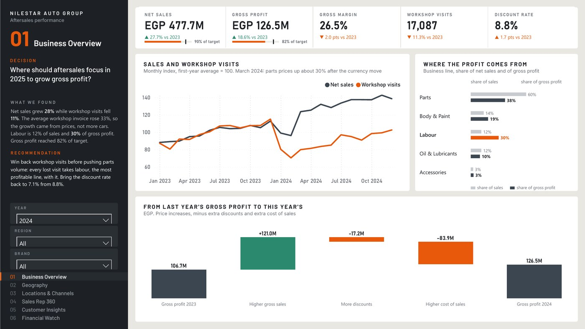
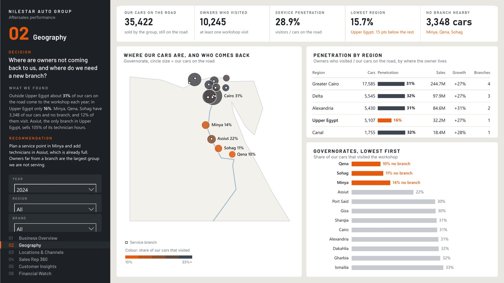
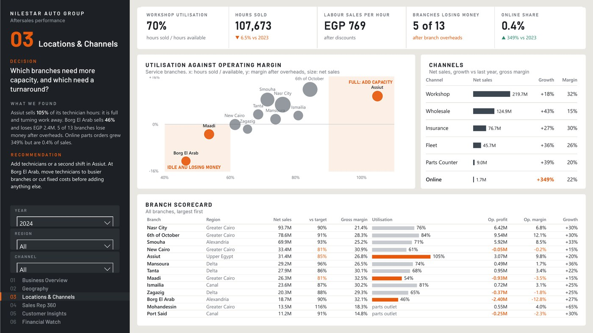
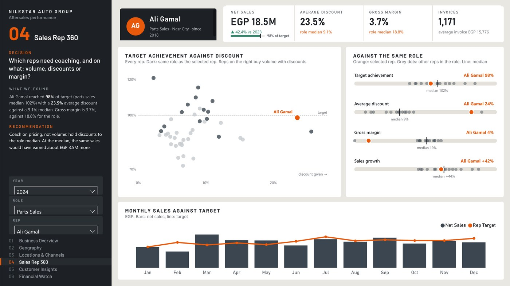
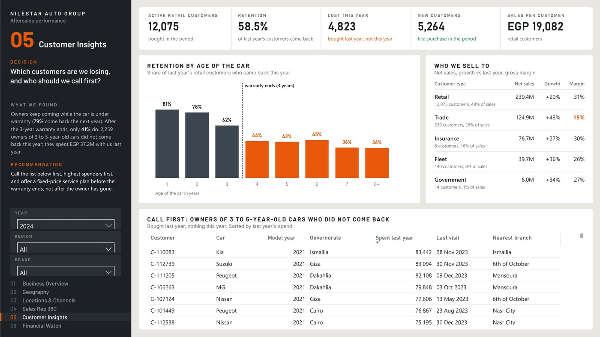
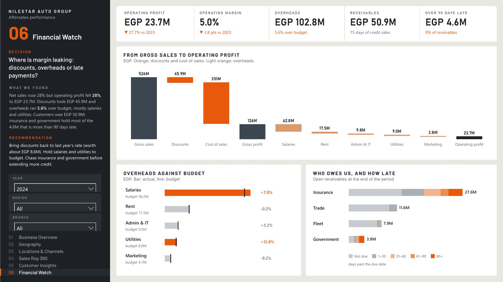

# Aftersales Performance

> **Decision:** Which branches, reps and customers should aftersales act on first to grow gross profit?

`Automotive` · Dec 2024 · `Power BI` · `Power Query` · `DAX` · `RLS`

> **Sample data.** A fictional multi-brand car distributor in Egypt (Nilestar Auto Group): 13 branches, 45 reps, 23,392 customers and 155,980 invoice lines, 2023 to 2024, in EGP. Generated with a fixed seed (`gen_data.py`) and included in this folder so the project opens and refreshes.

## Key findings

- Net sales rose **27.7%** to **EGP 477.7M**, but workshop visits fell **11.3%**: the average workshop invoice rose 33%, so the growth came from prices, not more cars.
- Labour is 12% of sales and **30%** of gross profit. Gross profit reached 82% of target and the gross margin fell 2.0 pts to 26.5%.
- Owners come back while the car is under warranty (**79%** the next year) and leave when it ends (**41%**). 2,259 owners of 3 to 5-year-old cars did not return in 2024; they spent EGP 37.2M the year before.
- Upper Egypt has a **16%** service penetration against about 31% elsewhere. Sohag, Minya and Qena have 3,348 of our cars and no branch, and Assiut, the only branch there, sells **105%** of its technician hours.
- Operating profit fell **27.7%** to EGP 23.7M: discounts rose to 8.8% of gross sales, overheads ran 5.6% over budget, and EGP 4.6M of receivables is more than 90 days late, mostly from insurers and government.

## About the report

Six pages: Business Overview, Geography, Locations & Channels, Sales Rep 360, Customer Insights and Financial Watch. Each page opens with the decision it supports, what was found and a recommendation, all calculated in DAX so they change with the slicers. Row-level security by branch.

## Report pages

### Business Overview

### Geography

### Locations & Channels

### Sales Rep 360

### Customer Insights

### Financial Watch

## Full report

📄 [Aftersales_Performance.pdf](Aftersales_Performance.pdf)

## Open it in Power BI Desktop

This folder is a Power BI Project (PBIP): the report and semantic model are saved as text (PBIR + TMDL), so every change can be reviewed in Git. Open `Aftersales Performance.pbip`, point the *DataFilePath* parameter at `Aftersales_Sample.xlsx` in this folder if needed, and refresh. Most visuals use the free **HTML Content** visual from AppSource.

## Under the hood

### Pages
Every page opens with the decision it supports, what the data shows and a recommendation, all calculated from the data and updated with the slicers.
1. **Business Overview**: net sales and gross profit against target, workshop visits, discount rate, sales and visits indexed by month, each business line's share of sales and of gross profit, and the bridge from last year's gross profit to this year's.
2. **Geography**: our cars on the road against the owners who come back, by governorate (map) and region, and governorates with no branch.
3. **Locations & Channels**: workshop utilisation against operating margin by branch, channel growth and margin, and a branch scorecard.
4. **Sales Rep 360**: one rep against target and against every rep in the same role (discount, margin, growth), and monthly sales against target.
5. **Customer Insights**: retention by age of the car, customer types, and the call list of owners who stopped coming.
6. **Financial Watch**: gross sales to operating profit, overheads against budget, and receivables by customer type and days late.

### Definitions
- **Net sales** = gross sales − discounts. **Gross profit** = net sales − cost of sales (parts cost and technician cost).
- **Operating profit** = gross profit − branch overheads.
- **Workshop visit** = one retail workshop invoice. **Utilisation** = hours sold ÷ technician hours available.
- **Penetration** = owners with a workshop visit in the period ÷ our cars still on the road.
- **Retention** = last year's retail customers who bought again this year.
- **Receivables** = credit invoices not paid at the end of the period. **Days sales outstanding** = receivables ÷ credit sales × days in the period.

### Data model

| Table | Role | Columns |
|---|---|---|
| Fact_Sales | Fact | Channel |
| Fact_Invoice | Fact | (hidden keys) |
| Dim_Customer | Dimension | Customer, CustomerType, Governorate, Car, ModelYear, Nearest Branch |
| Dim_Branch | Dimension | Branch, Region, BranchType |
| Dim_Rep | Dimension | Rep, Role, Home Branch |
| Dim_Governorate | Dimension | Governorate, Region, Nearest Branch |
| Dim_BusinessLine | Dimension | Business Line |
| Dim_Brand | Dimension | Brand |
| Dim_CarAge | Dimension | Car Age, Car Age Label |
| Fact_BranchTarget | Fact | (hidden keys) |
| Fact_RepTarget | Fact | (hidden keys) |
| Fact_Overhead | Fact | Category |
| Fact_Capacity | Fact | (hidden keys) |
| Fact_CarsOnRoad | Fact | (hidden keys) |
| Dim_Date | Dimension | Date, Year, Month, Month Start |
| Dim_Month | Dimension | Month Start |
| _Refresh | Helper | (hidden keys) |

### Relationships

All single direction, many-to-one from fact to dimension.

- `Fact_Sales.InvoiceDate` → `Dim_Date.Date`
- `Fact_Sales.BranchID` → `Dim_Branch.BranchID`
- `Fact_Sales.CustomerID` → `Dim_Customer.CustomerID`
- `Fact_Sales.RepID` → `Dim_Rep.RepID`
- `Fact_Sales.BusinessLine` → `Dim_BusinessLine.Business Line`
- `Fact_Sales.VehicleBrand` → `Dim_Brand.Brand`
- `Fact_Invoice.InvoiceDate` → `Dim_Date.Date`
- `Fact_Invoice.BranchID` → `Dim_Branch.BranchID`
- `Fact_Invoice.CustomerID` → `Dim_Customer.CustomerID`
- `Dim_Customer.Governorate` → `Dim_Governorate.Governorate`
- `Fact_BranchTarget.Month` → `Dim_Date.Date`
- `Fact_BranchTarget.BranchID` → `Dim_Branch.BranchID`
- `Fact_BranchTarget.BusinessLine` → `Dim_BusinessLine.Business Line`
- `Fact_RepTarget.Month` → `Dim_Date.Date`
- `Fact_RepTarget.RepID` → `Dim_Rep.RepID`
- `Fact_Overhead.Month` → `Dim_Date.Date`
- `Fact_Overhead.BranchID` → `Dim_Branch.BranchID`
- `Fact_Capacity.Month` → `Dim_Date.Date`
- `Fact_Capacity.BranchID` → `Dim_Branch.BranchID`
- `Fact_CarsOnRoad.Governorate` → `Dim_Governorate.Governorate`
- `Fact_CarsOnRoad.VehicleBrand` → `Dim_Brand.Brand`

### Security roles

- **Branch Manager**: Each branch manager sees only their branch's sales, targets, overheads and receivables. Rule: `Dim_Branch`: `Dim_Branch[BranchManagerEmail] = USERPRINCIPALNAME ()`
- **Leadership**: Full read access. Rule: no filter (full read)
