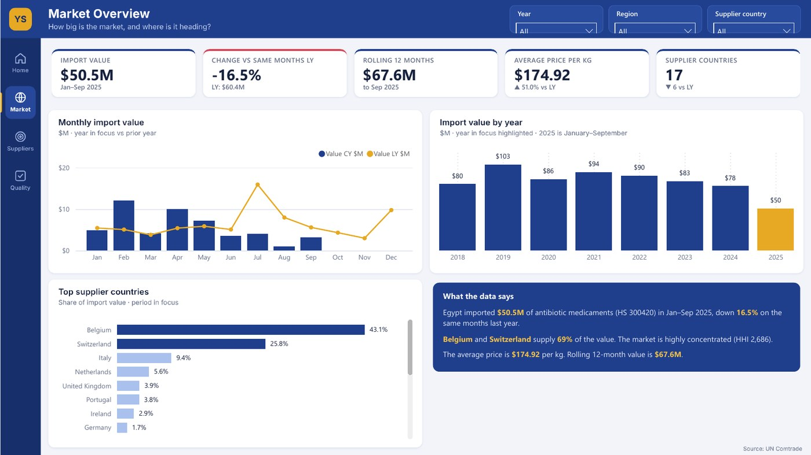
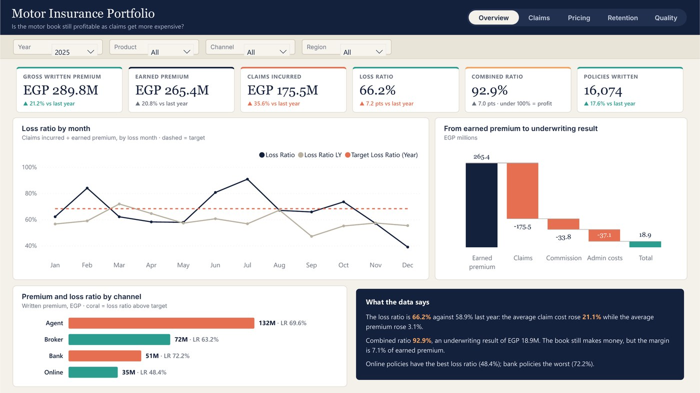
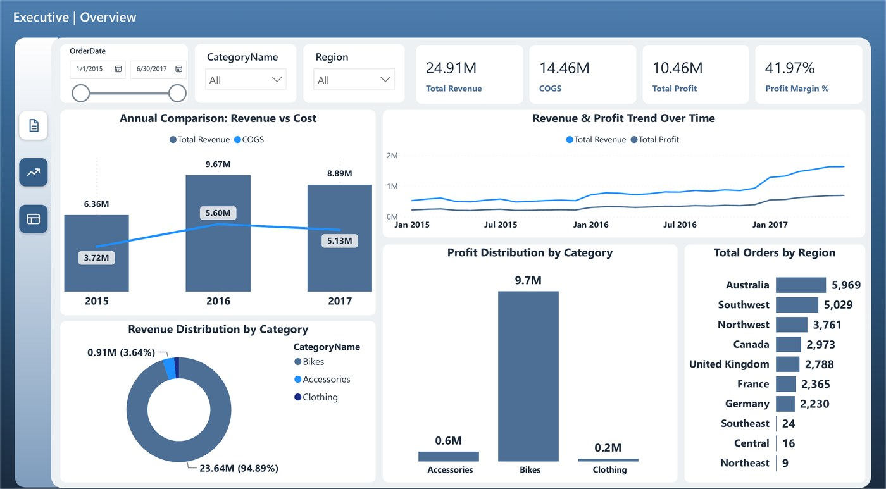
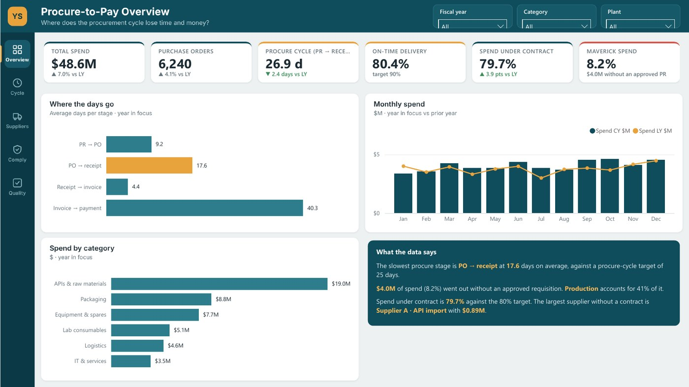
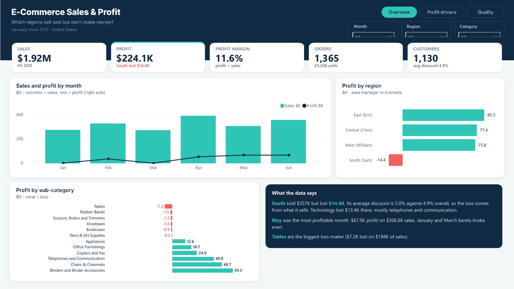
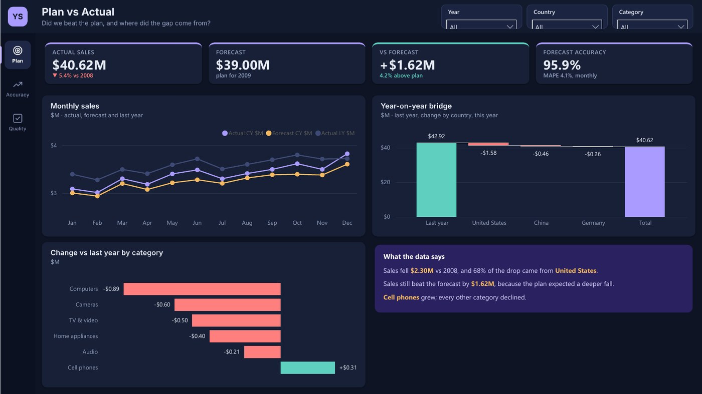
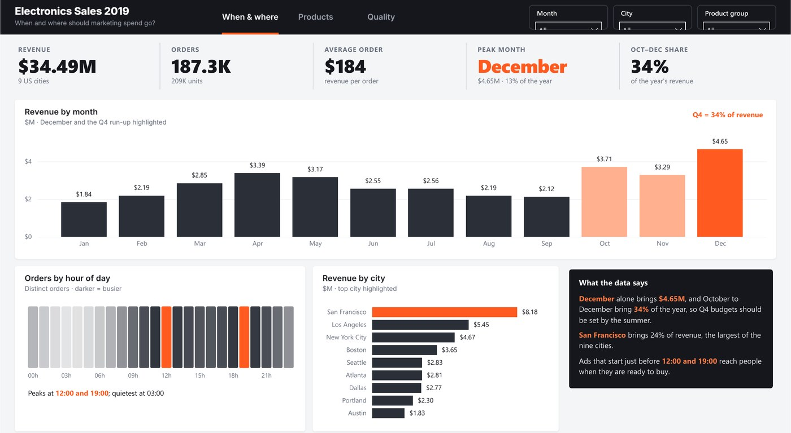
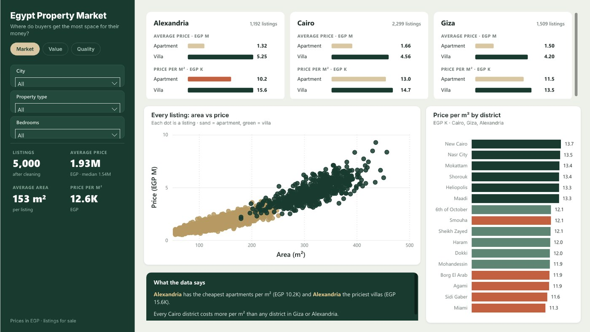

# Power BI Projects

Dashboards by **[Youssef Saeed](https://youssefsaeed-portfolio.vercel.app/)**. Each one starts from the decision it supports and ends with findings someone can act on.

Every project is saved as a **Power BI Project (PBIP)**: the semantic model (TMDL) and report (PBIR) are plain text, with documented measures, row-level security and data quality checks.

| | Project | Decision | Tools |
|---|---|---|---|
|  | **[Inventory Management](01-inventory-management)** · 5 pages | Revenue is up 21.8% but stockouts are rising: which products need higher reorder points? | Power BI, DAX, RLS, Data quality |
|  | **[Pharmaceutical Trade Intelligence, Egypt](02-pharma-trade-intelligence-egypt)** · 4 pages | Should Egypt diversify its antibiotic sourcing beyond two supplier countries? | Power BI, Power Query, Data quality |
|  | **[Motor Insurance Portfolio](09-motor-insurance-portfolio)** · 5 pages | Which customer segments should be repriced, and by how much? | Power BI, Power Query, DAX, RLS |
|  | **[Sales Tracker](03-sales-tracker)** · 3 pages | Keep relying on bikes, or grow higher-margin accessories? | Power BI, DAX |
|  | **[Procure-to-Pay Performance](04-procure-to-pay)** · 5 pages | Which suppliers and plants should we fix first to cut delays and off-contract buying? | Power BI, DAX, RLS, Governance |
|  | **[E‑Commerce Sales & Profit](05-ecommerce-sales-profit)** · 3 pages | Where should discounts be capped and pricing fixed to stop losing money? | Power BI, Power Query, DAX, RLS |
|  | **[Sales vs Forecast](06-sales-vs-forecast)** · 3 pages | How should next year's forecast be corrected, and for which countries? | Power BI, DAX, Forecasting |
|  | **[Electronics Sales 2019](07-electronics-sales-2019)** · 3 pages | When and where should marketing spend go? | Power BI, Power Query, DAX |
|  | **[Egypt Property Market](08-egypt-property-market)** · 3 pages | Where does a buyer get the most space for their budget? | Power BI, Power Query, DAX |

## Connect

[Portfolio](https://youssefsaeed-portfolio.vercel.app/) · [LinkedIn](https://www.linkedin.com/in/youssef-saeed1/) · [Email](mailto:youssefsaeed206@gmail.com) · [Book a call](https://cal.com/youssefsaeed)
