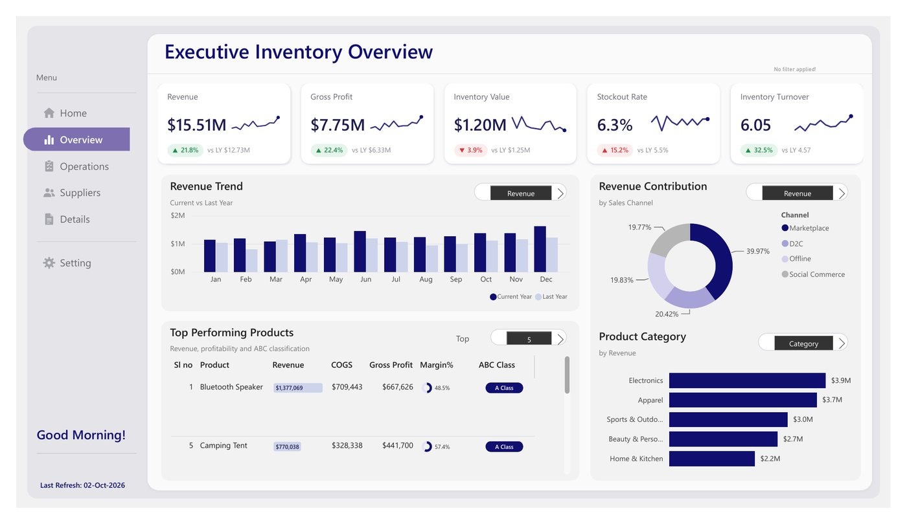
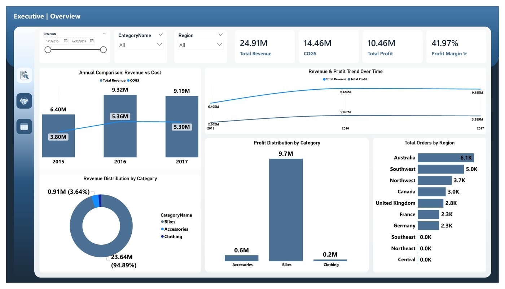
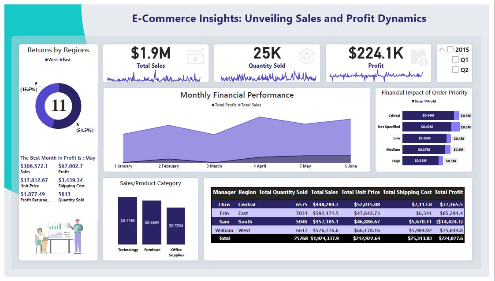
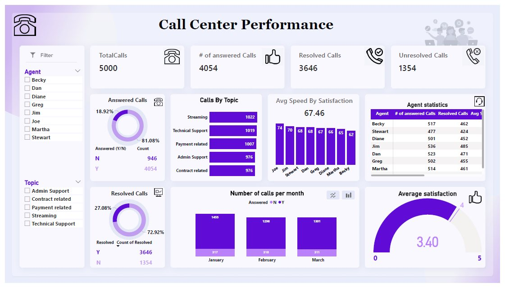
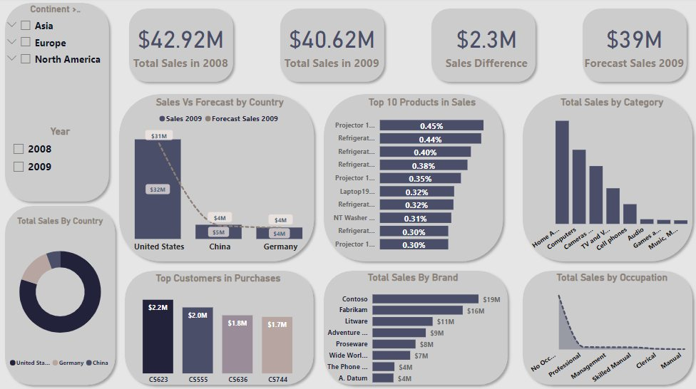
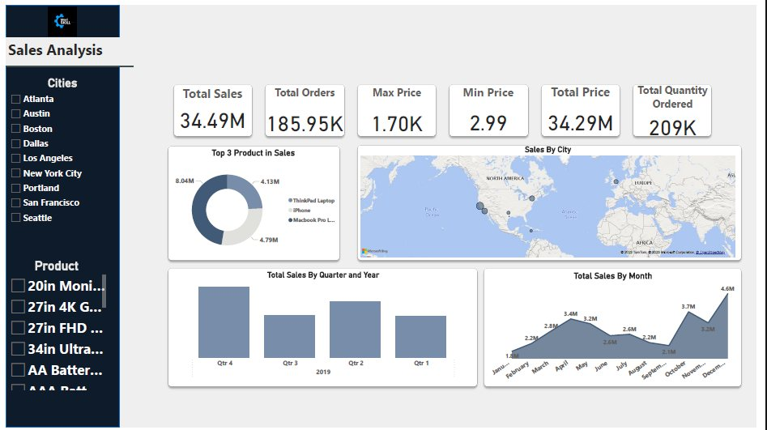
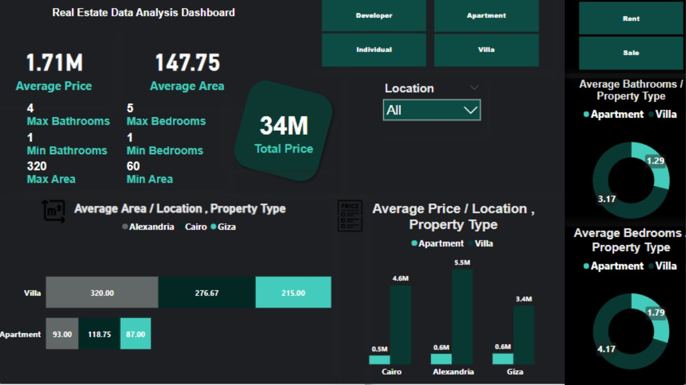

# Power BI Projects

Dashboards by **[Youssef Saeed](https://youssefsaeed1.github.io/portfolio/)**. Each one starts from a business question and ends with findings someone can act on.

| | Project | Business question | Tools |
|---|---|---|---|
|  | **[Inventory Management](01-inventory-management)** · 4 pages | Revenue is up 21.8%, so why are stockouts rising? | Power BI, DAX, Data modeling, Power Query |
|  | **[Sales Tracker](02-sales-tracker)** · 4 pages | How much does the business depend on one category? | Power BI, DAX |
|  | **[E‑Commerce Sales & Profit](03-ecommerce-sales-profit)** | Which regions sell well but don't make money? | Power BI, Power Query |
|  | **[Call Center Performance](04-call-center-performance)** | How many calls actually get resolved? | Power BI, DAX |
|  | **[Sales and Forecast](05-sales-and-forecast)** | How did 2009 compare with last year and the forecast? | Power BI, Forecasting |
|  | **[Sales Analysis](06-sales-analysis)** | When and where do electronics sales peak? | Power BI |
|  | **[Egypt Real Estate Market](07-egypt-real-estate)** | Where are villas and apartments priced highest? | Python, Pandas, Power BI |

## Connect

[Portfolio](https://youssefsaeed1.github.io/portfolio/) · [LinkedIn](https://www.linkedin.com/in/youssef-saeed1/) · [Email](mailto:youssefsaeed206@gmail.com)
